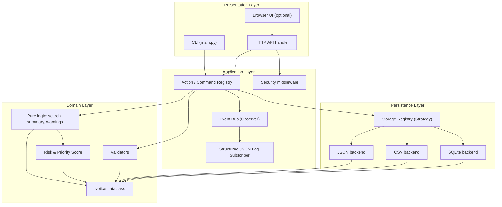
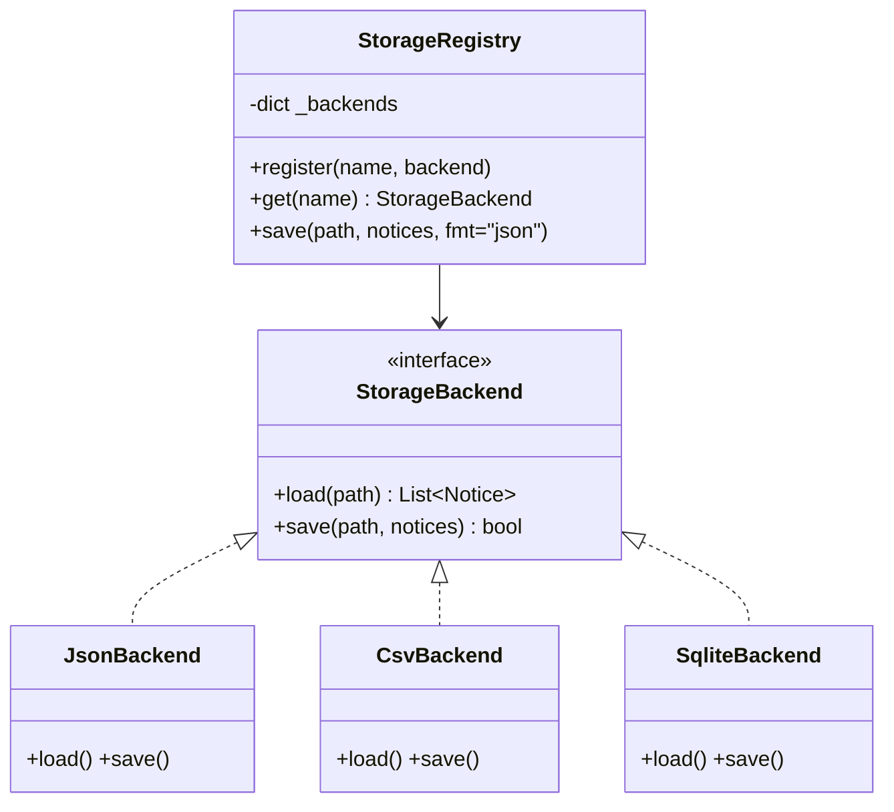
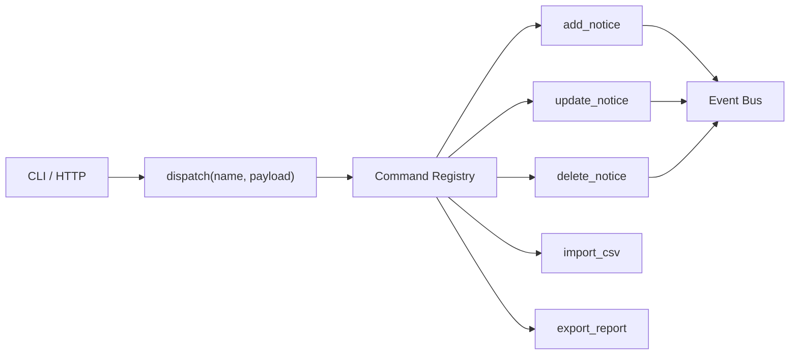
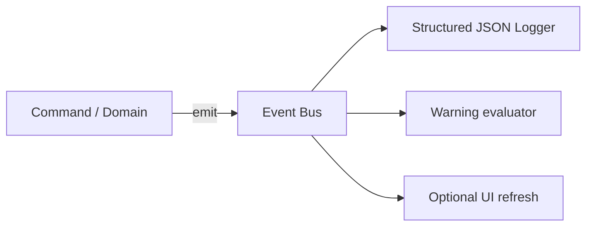
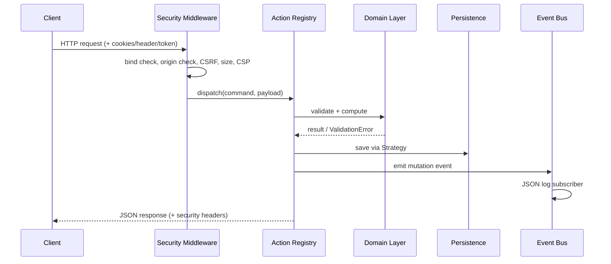

# Software Requirements Specification (SRS)
## Notice Board Organizer

| Field | Value |
| --- | --- |
| Project | Notice Board Organizer — LocalImpact Challenge, Project #30 (Campus & Administration) |
| Version | 1.0.0 |
| Status | Final — implementation specification |
| Date | 2026-11-22 |
| Scope | Hybrid application: Python stdlib domain engine + CLI + local HTTP API + security |

---

## Table of Contents

1. [Introduction](#1-introduction)
2. [Scope](#2-scope)
3. [Stakeholders](#3-stakeholders)
4. [Functional Requirements](#4-functional-requirements)
5. [Non-Functional Requirements](#5-non-functional-requirements)
6. [Architecture](#6-architecture)
7. [Data Model / Schema](#7-data-model--schema)
8. [API Reference (Summary)](#8-api-reference-summary)
9. [Notice Risk & Priority Score (Novel Algorithm)](#9-notice-risk--priority-score-novel-algorithm)
10. [Testing Strategy](#10-testing-strategy)
11. [Traceability Matrix](#11-traceability-matrix)
12. [Resolution of Contradictions in the Brief](#12-resolution-of-contradictions-in-the-brief)
13. [Glossary](#13-glossary)

---

## 1. Introduction

### 1.1 Purpose

This Software Requirements Specification defines the complete functional and non-functional requirements for the **Notice Board Organizer**, a tool that lets campus administrators record, validate, search, summarise, and export official notices with category, posting date, and expiry date. It also specifies a secure local HTTP API, a deterministic risk-scoring algorithm, and the four-layer architecture that binds them together.

This document is the authoritative contract used by both the Python implementation and the JavaScript cross-language parity check. Where a formula or endpoint behaviour is given, it is to be implemented exactly as written.

### 1.2 Product Vision

Campus notice boards are chaotic: paper notices go stale, expiry dates are missed, and there is no quick way to answer "what is overdue?" or "what expires this week?". The Notice Board Organizer turns an unstructured board into a **validated, persistent, queryable record system** that surfaces urgent notices automatically through a deterministic priority score.

### 1.3 Document Conventions

- **MUST**, **SHALL**, **MUST NOT** indicate mandatory requirements.
- **SHOULD** indicates a strong recommendation.
- **MAY** indicates an optional/stretch capability.
- All dates are ISO `YYYY-MM-DD` (`%Y-%m-%d`).
- "Today" `T` means the current local calendar date at evaluation time.
- Integers are 64-bit; the FNV-1a hash is explicitly 32-bit unsigned.

---

## 2. Scope

### 2.1 In Scope

**Core (from the original problem brief):**
- Add / edit / delete notices with **category**, **date posted**, **expiry date**, **title**, **author**, and **description**.
- **Strict validation** of all user input: types, ranges, allowed categories, date format, and date ordering (`expiry ≥ posted`).
- **JSON persistence** (corruption-safe, atomic write) and **CSV persistence** (load + export).
- **Search / filter** by keyword (title, description, author) and category.
- **Executive summary** with totals, status breakdown, averages, and threshold warnings.

**Stretch goals:**
- Multi-format **export** to Markdown (`.md`), plain-text audit log (`.txt`), and CSV (`.csv`).
- **Threshold warnings** for overdue notices and notices expiring within 3 days (summary additionally counts expiring within 7 days).
- Bulk **CSV import** with row-level error logging (invalid rows are skipped with a reason, valid rows are added).
- Optional GUI / TUI — the CLI is the baseline; a browser front-end is provided via the HTTP API.
- Novel **Notice Risk & Priority Score** (deterministic, explainable, bounded `[0,1]`).
- Secure **HTTP API** with CSRF protection, bearer token, origin checks, loopback binding, static-file whitelist, body-size limit, CSP, and HTML escaping.
- **Structured JSON event log** via the Observer pattern.

### 2.2 Out of Scope

- Multi-user authentication / account management (a single shared bearer token is sufficient).
- Remote network exposure — the HTTP API binds to loopback (`127.0.0.1`) only by design.
- Relational database server, message broker, or any external service.
- Third-party charting libraries (Matplotlib) — charts are replaced by dependency-free text/canvas summaries.
- Mobile native applications.

### 2.3 Deliverables

| Deliverable | Location |
| --- | --- |
| Domain engine, CLI, HTTP API, security | `main.py`, `models.py`, `validation.py`, `logic.py`, `storage.py`, `reporting.py`, `seed_data.py` (+ application-layer modules) |
| This SRS | `docs/SRS.md` |
| Full API reference | `docs/API_REFERENCE.md` |
| Presentation deck | `docs/NoticeBoardOrganizer_Presentation.pptx` (+ `docs/make_pptx.py`) |
| Word documentation | `docs/NoticeBoardOrganizer_Documentation.docx` (+ `docs/make_docx.py`) |
| Smoke tests | `test_app.py` |

---

## 3. Stakeholders

| Stakeholder | Interest | Influence |
| --- | --- | --- |
| **Campus administrators** | Create and maintain notices; need overdue/expiring visibility | Primary end users |
| **Students / faculty** | Consume notices; benefit from clear summaries and exports | Secondary beneficiaries |
| **Hackathon judges** | Evaluate correctness, architecture, security, novelty, documentation | Evaluate against rubric |
| **Developers / maintainers** | Need modular, testable, portability-friendly code | Build and extend the system |
| **Reviewers / QA** | Need deterministic algorithms, invariants, and API tests | Verify quality gates |

---

## 4. Functional Requirements

Requirements are numbered `FR-x` and mapped to the original PDF problem brief.

### 4.1 Notice Lifecycle

| ID | Requirement | Brief Mapping | Priority |
| --- | --- | --- | --- |
| FR-1 | The system SHALL allow creating a notice with `title`, `category`, `date_posted`, `expiry_date`, `author`, `description` and a system-assigned integer `id`. | Core: "store notices with category/date/expiry" | MUST |
| FR-2 | The system SHALL assign IDs monotonically as `max(existing ids) + 1`. | Derived | MUST |
| FR-3 | The system SHALL allow updating any mutable field of an existing notice by `id`; blank fields keep current values (CLI) / omitted JSON keys keep current values (API `PUT`). | Core | MUST |
| FR-4 | The system SHALL allow deleting a notice by `id` and report whether a record was removed. | Core | MUST |
| FR-5 | The system SHALL recompute `status` from `expiry_date` relative to `T` on every load, add, update, and summary operation. | Brief: "expiry status", "correct even after restart" | MUST |

### 4.2 Validation

| ID | Requirement | Brief Mapping | Priority |
| --- | --- | --- | --- |
| FR-6 | `title`, `author`, `description` SHALL be trimmed; empty `title` SHALL be rejected; length SHALL be `≤ 120` characters; control characters SHALL be collapsed to spaces. | Core: "strict validation" | MUST |
| FR-7 | `category` SHALL be one of the seven allowed, lowercased values: `academics, events, administration, maintenance, sports, deadlines, general`. | Core | MUST |
| FR-8 | Dates SHALL be strict `YYYY-MM-DD`; invalid formats SHALL be rejected. | Core: "strict validation" | MUST |
| FR-9 | `expiry_date` SHALL NOT be earlier than `date_posted` (`validate_date_range`). | Core: "date order" | MUST |
| FR-10 | Interactive prompts SHALL re-prompt until valid (defensive input loop); programmatic/API entry SHALL return a structured error instead. | Core | MUST |
| FR-11 | On bulk import, each row SHALL be validated independently; invalid rows SHALL be skipped with a logged reason and valid rows imported. | Stretch: "bulk CSV import with row-level error logs" | MUST |

### 4.3 Persistence

| ID | Requirement | Brief Mapping | Priority |
| --- | --- | --- | --- |
| FR-12 | Notices SHALL be persisted to `data/notices.json` as a JSON array of objects. | Core: "JSON persistence" | MUST |
| FR-13 | JSON writes SHALL be atomic: write to `*.tmp`, then `os.replace()`. | Core: "corruption-safe" | MUST |
| FR-14 | Missing, empty, or corrupt JSON SHALL be tolerated (`[]` returned) without crashing. | Core: reliability | MUST |
| FR-15 | CSV load and CSV export SHALL use the fixed field order `id,title,category,date_posted,expiry_date,status,author,description`. | Core + stretch | MUST |
| FR-16 | Storage backends SHALL implement a common interface and be selectable via a **registry** (Strategy pattern): `json`, `csv`, and `sqlite`. | Architecture requirement | MUST |

### 4.4 Search, Summary, Warnings

| ID | Requirement | Brief Mapping | Priority |
| --- | --- | --- | --- |
| FR-17 | Search SHALL filter by case-insensitive keyword over `title + description + author` and by exact lowercased `category`. | Core: "search" | MUST |
| FR-18 | Summary SHALL report `total`, `active`, `upcoming`, `expired`, `overdue`, `expiring_soon` (0–7 days), `avg_days_remaining`, and `category_counts`. | Core: "summary" | MUST |
| FR-19 | Warnings SHALL flag notices with `days_remaining < 0` as `OVERDUE by N day(s)` and `0 ≤ days_remaining ≤ 3` as `Expires in N day(s)`. | Stretch: "threshold warnings" | MUST |

### 4.5 Export and Import

| ID | Requirement | Brief Mapping | Priority |
| --- | | --- | --- |
| FR-20 | Export SHALL support Markdown (`.md`), plain-text audit log (`.txt`), and CSV (`.csv`). | Stretch: "multi-format export MD/TXT/CSV" | MUST |
| FR-21 | Markdown export SHALL include an executive summary, a notices table, and a warnings section. | Stretch | MUST |
| FR-22 | CSV import SHALL support append mode (new IDs) and replace mode (clear then import). | Stretch | MUST |

### 4.6 API, Security, Patterns, Scoring

| ID | Requirement | Brief Mapping | Priority |
| --- | --- | --- | --- |
| FR-23 | All domain operations SHALL be reachable via a local HTTP API with the endpoints listed in §8 / `API_REFERENCE.md`. | Rubric: web API | MUST |
| FR-24 | The API SHALL be protected by: loopback-only bind, `Origin`/`Referer` checks, double-submit CSRF (HttpOnly session cookie + readable CSRF cookie echoed in a header), optional `Authorization: Bearer` token, strict CSP, static-file whitelist, request body-size limit, and HTML escaping. | Rubric: security | MUST |
| FR-25 | Mutations and scoring SHALL be dispatched through a **Command registry**; events SHALL be emitted through an **Observer event bus** to a structured JSON logging subscriber. | Rubric: design patterns | MUST |
| FR-26 | The **Notice Risk & Priority Score** SHALL be computed exactly per §9, yielding a deterministic `clamp01` value rounded to 6 decimals (ROUND_HALF_UP), with Python and JavaScript producing identical results. | Rubric: novelty / algorithm | MUST |
| FR-27 | An optional browser UI MAY consume the API; the CLI remains fully functional without it. | Stretch: GUI/TUI optional | MAY |

---

## 5. Non-Functional Requirements

| ID | Category | Requirement |
| --- | --- | --- |
| NFR-1 | **Reliability** | Corrupt/missing/empty data MUST NOT crash the app; every file access is wrapped in `try/except`; atomic writes prevent partial files. |
| NFR-2 | **Reliability** | Status is always *derived*, never trusted from stored data — a restart recomputes overdue flags correctly. |
| NFR-3 | **Reliability** | Every API mutation emits an event; logs are newline-delimited JSON (JSONL) so a single malformed event cannot break the log. |
| NFR-4 | **Security** | HTTP server binds to `127.0.0.1` only; no wildcard `0.0.0.0` bind. |
| NFR-5 | **Security** | Cross-origin writes are rejected by `Origin`/`Referer` allow-list; CSRF double-submit cookie must equal the `X-CSRF-Token` header. |
| NFR-6 | **Security** | Session cookie is `HttpOnly; SameSite=Strict`; CSRF cookie is readable by JS but not trusted alone. |
| NFR-7 | **Security** | Bearer token comparison uses constant-time `hmac.compare_digest`. |
| NFR-8 | **Security** | Static file serving is restricted to an explicit whitelist (no path traversal via `..` or absolute paths). |
| NFR-9 | **Security** | Request bodies larger than 1 MiB are rejected with `413`; HTML output is escaped to prevent stored XSS. |
| NFR-10 | **Security** | Strict `Content-Security-Policy: default-src 'self'; script-src 'self'; object-src 'none'` plus `X-Content-Type-Options: nosniff`. |
| NFR-11 | **Performance** | In-memory operations over the target dataset (≤ 10,000 notices) complete in < 100 ms; score computation is O(n) per request with a single pass. |
| NFR-12 | **Performance** | JSON save is O(n); atomic replace ensures durability without fsync latency concerns at demo scale. |
| NFR-13 | **Portability** | Python 3.10+ on Windows, macOS, Linux; only the standard library is required for the core. |
| NFR-14 | **Portability** | No OS-specific path separators in code — use `os.path.join`; ANSI colours degrade gracefully. |
| NFR-15 | **Maintainability** | Four-layer separation (§6); pure domain functions have no I/O; every backend is a drop-in Strategy. |
| NFR-16 | **Determinism** | Given identical inputs (notices + `T`), the score and all exports are byte-identical across runs and languages. |
| NFR-17 | **Usability** | 2-minute guided demo; menu options 1–9 + 0; every error message is actionable. |
| NFR-18 | **Testability** | Unit, invariant/property, end-to-end API, and browser QA layers are all automatable with stdlib + Playwright. |

---

## 6. Architecture

### 6.1 Four-Layer Overview

The system is organised into four layers with strictly inward dependencies:



- **Presentation** — anything the user touches: the colour terminal menu, the optional browser UI, and the HTTP request/response serializer. It contains no business rules.
- **Application** — use-case orchestration: the Command registry maps an action name to a handler; the event bus broadcasts domain events; the security middleware enforces policy before handlers run; the structured logger subscribes to events.
- **Domain** — the heart: the `Notice` entity, pure functions (`search`, `summary`, `warnings`, `next_id`, `refresh_all`), validators, and the risk algorithm. Zero I/O, zero framework imports.
- **Persistence** — storage Strategies behind a common interface, selected by a registry.

### 6.2 Strategy Pattern — Storage Registry



`save(path, notices, fmt)` resolves the backend from the registry at runtime. Adding a new format (e.g. YAML) is a one-line `register()` call — no changes to callers.

### 6.3 Command Pattern — Action Registry

Each mutation is a command object (or callable) registered under a stable key (`add`, `update`, `delete`, `import`, `export`, …). Both the CLI menu and API routes dispatch through this registry, guaranteeing identical behaviour between interfaces.



### 6.4 Observer Pattern — Event Bus



Events are dictionaries with at least: `event` (name), `timestamp` (ISO-8601 UTC), `actor`, and a `data` object. The JSON logger writes one compact JSON object per line to `data/events.jsonl`, producing an auditable trail of all mutations.

**Asynchronous delivery for high concurrency:** the bus publishes to a bounded
(`10,000` entry) queue drained by a daemon worker thread, so slow sinks (disk,
network) never block request handling. `emit()` is non-blocking; `emit_sync()`
delivers inline for critical paths; `flush()` waits for pending delivery and
`shutdown()` drains then stops the worker. Under sink back-pressure the queue
falls back to inline delivery rather than dropping events. The `FileSink` uses
its own lock for safe concurrent appends. Tests (`tests/test_async_auth.py`)
verify 50-event async delivery, sync delivery, and JSONL file-sink integrity.

### 6.5 Request Flow (HTTP)



---

## 7. Data Model / Schema

### 7.1 `Notice` Entity

| Field | Type | Required | Default | Validation | Notes |
| --- | --- | --- | --- | --- | --- |
| `id` | int | Yes | — | `> 0`, assigned by `next_id()` | Monotonic `max+1`; unique. |
| `title` | str | Yes | — | trim, `1–120` chars, no control chars | Keyword search target. |
| `category` | str | Yes | — | lowercase, one of `VALID_CATEGORIES` | Drives category weight in score. |
| `date_posted` | date | Yes | — | strict `YYYY-MM-DD` | `P` in the algorithm. |
| `expiry_date` | date | Yes | — | strict `YYYY-MM-DD`, `≥ date_posted` | `E` in the algorithm. |
| `status` | str | No | `Active` | one of `Active / Expired / Upcoming` | **Always recomputed**; stored value is advisory. |
| `author` | str | No | `Admin` | trim, `≤ 120` chars | Keyword search target. |
| `description` | str | No | `""` | trim, `≤ 120` chars | Keyword search target. |

### 7.2 Status Derivation

| Condition | Status |
| --- | --- |
| `expiry_date < T` | `Expired` |
| `expiry_date == T` | `Active` |
| `expiry_date > T` | `Upcoming` |

### 7.3 Serialization

- `Notice.to_dict()` → dates as `YYYY-MM-DD` strings (`DATE_FORMAT`).
- `Notice.from_dict(data)` → parses ISO or `date` objects, calls `refresh_status()` on construction.
- CSV column order: `id,title,category,date_posted,expiry_date,status,author,description`.
- SQL storage (Strategy) uses a `notices` table with the same columns (`id INTEGER PRIMARY KEY`, text fields, DATE-as-ISO text).

### 7.4 Database Indexing & Scalability (SQLite Strategy)

Domain algorithms are O(n) over the in-memory collection, which is optimal for
the dataset sizes in scope (hackathon demo: tens to thousands of records). To
support **very large persisted datasets**, the SQLite backend adds indexes on
the high-selectivity columns used by filtering and expiry queries:

| Index | Columns | Query it accelerates |
| --- | --- | --- |
| `idx_notices_category` | `category` | `WHERE category = ?` (category filter) |
| `idx_notices_expiry` | `expiry_date` | `WHERE expiry_date < ?` (overdue / expiring range) |
| `idx_notices_status` | `status` | `WHERE status = ?` (status filter) |
| `idx_notices_category_expiry` | `(category, expiry_date)` | combined category + expiry filtering |
| `idx_notices_posted` | `date_posted` | posted-date range / sort |

Indexed query methods (`query_by_category`, `query_expiring_before`,
`query_by_status`) issue SQL predicate queries rather than scanning the whole
table. `explain_index_usage()` exposes `EXPLAIN QUERY PLAN`, and the automated
test suite (`tests/test_indexing.py`) asserts both index existence and that the
planner uses `idx_notices_category`, `idx_notices_expiry`, and
`idx_notices_status`. Index creation is idempotent
(`CREATE INDEX IF NOT EXISTS`). Writes remain atomic (temp file + `os.replace`
for JSON/CSV; transactional `DELETE`+`executemany` for SQLite).

### 7.5 JSON Store Example

```json
[
  {
    "id": 1,
    "title": "Midterm Examination Schedule",
    "category": "academics",
    "date_posted": "2026-10-01",
    "expiry_date": "2026-11-30",
    "status": "Upcoming",
    "author": "Registrar",
    "description": "Midterm exam timetable is published."
  }
]
```

---

## 8. API Reference (Summary)

The authoritative, exhaustive reference — with full request/response JSON, `curl` examples, and per-endpoint security notes — is **`docs/API_REFERENCE.md`**. The endpoint set is:

| Method | Path | Purpose | Key Security |
| --- | --- | --- | --- |
| `GET` | `/api/health` | Liveness + version | CSP headers only |
| `GET` | `/api/notices` | List (filter `category`, `q`, `sort`) | Origin check, CSP |
| `POST` | `/api/notices` | Create notice | CSRF + bearer + origin |
| `GET` | `/api/notices/{id}` | Retrieve one | Origin check, CSP |
| `PUT` | `/api/notices/{id}` | Update one | CSRF + bearer + origin |
| `DELETE` | `/api/notices/{id}` | Delete one | CSRF + bearer + origin |
| `GET` | `/api/summary` | Executive summary | Origin check, CSP |
| `GET` | `/api/warnings` | Threshold warnings | Origin check, CSP |
| `POST` | `/api/export` | Export MD/TXT/CSV | CSRF + bearer + whitelist path |
| `POST` | `/api/import` | Bulk CSV import | CSRF + bearer + size limit |
| `GET` | `/api/risk/{id}` | Risk score for one notice | Origin check, CSP |
| `GET` | `/api/events` | Recent structured events | Bearer recommended |

**Error codes:** `400` bad request/malformed JSON, `401` missing/invalid bearer token, `403` CSRF/origin failure, `404` not found, `413` body too large, `422` validation failure, `500` internal error.

**Security behaviour (all state-changing endpoints):** loopback bind, `Origin`/`Referer` allow-list, double-submit CSRF (session cookie `HttpOnly`, CSRF cookie readable and echoed via `X-CSRF-Token`), optional bearer token via constant-time compare, static-file whitelist, 1 MiB body cap, strict CSP, and HTML escaping of all user-controlled strings in any HTML response.

### 8.1 Granular Authorization Roles

Two roles are enforced on every API request via `application/auth.py`
(`authorize(headers, permission)`):

| Role | `read` | `add` | `update` | `delete` | `import` | `export` |
| --- | --- | --- | --- | --- | --- | --- |
| **Viewer** | ✅ | ❌ | ❌ | ❌ | ❌ | ❌ |
| **Admin** | ✅ | ✅ | ✅ | ✅ | ✅ | ✅ |

The role is resolved from `X-Role: viewer|admin` or from a `token:role` suffix in
the bearer token (e.g. `Authorization: Bearer <token>:viewer`). When no API
bearer token is configured the app runs in single-user Admin mode for backwards
compatibility. Denials emit `auth.denied` and return `403` with the reason.
`tests/test_async_auth.py` verifies the permission matrix and token/header
resolution.

---

## 9. Notice Risk & Priority Score (Novel Algorithm)

### 9.1 Purpose

The score converts each notice into a single deterministic number in `[0,1]` that expresses "how much attention this notice deserves right now". It is **novel** in this domain because it blends four orthogonal signals — calendar urgency, information staleness, a stable per-category weight, and a history-aware repetition factor — into a fully explainable, dependency-free metric. Unlike a black-box classifier, every contribution is inspectable and reproducible.

> Related concepts such as a *non-reversible derived fingerprint* (a one-way digest used only for identity, not scoring) and *hybrid distance metrics* (combining temporal + categorical distance) are acknowledged in the literature, but the algorithm actually implemented here is the **weighted risk score defined below**. No hashing is used to hide information — the FNV-1a hash is used only to derive a *stable, reproducible category weight*.

### 9.2 Formal Definition

**Inputs:** notice with expiry `E`, date posted `P`, category `C`; evaluation date `T` (today).

**Step 1 — Urgency.**
```
days_until_expiry = (E - T).days
urgency = 1 if days_until_expiry < 0 else clamp01(1 - days_until_expiry / 30)
```
An overdue notice (`days_until_expiry < 0`) has `urgency = 1`. A notice expiring exactly today has `urgency = 1`. A notice ≥ 30 days out has `urgency = 0`. Linear taper in between.

**Step 2 — Staleness.**
```
staleness = clamp01( (T - P).days / 90 )
```
A notice posted today has staleness `0`; one ≥ 90 days old has staleness `1`.

**Step 3 — Category weight.**
```
h = fnv1a32( utf8( C.lower() ) )
category_weight = (h mod 1000) / 1000
```
FNV-1a 32-bit: offset basis `2166136261`, prime `16777619`. For each byte `b` of the UTF-8 encoded **lowercased** category string:
```
h = (h * 16777619) mod 2^32
h = (h XOR b) mod 2^32
```
The result is a deterministic float in `[0, 0.999]`. It is *not* security-sensitive; it simply gives every category a stable, language-independent "priority flavour".

**Step 4 — History factor.**
```
same_category = [n for n in notices if n.id < current.id and n.category.lower() == C.lower()]
ratio = (# expired-or-overdue among same_category) / max(1, len(same_category))
history_factor = 0.5 + 0.5 * ratio
```
Computed only over records with a **lower id** (history-aware, deterministic, independent of roster order). A category with no overdue history yields `0.5`; a category where all prior notices are overdue yields `1.0`.

**Step 5 — Weighted sum.**
```
score = clamp01(
    0.45 * urgency
  + 0.20 * staleness
  + 0.20 * category_weight
  + 0.15 * history_factor
)
```

**Step 6 — Output rounding.**
Round to **6 decimal places** using **ROUND_HALF_UP** (Python: `Decimal(str(score)).quantize(Decimal("0.000001"), rounding=ROUND_HALF_UP)`; JavaScript: implement half-up via `Math.round((x + Number.EPSILON) * 1e6) / 1e6` or an equivalent decimal routine — both MUST match).

Where `clamp01(x) = min(1.0, max(0.0, x))`.

### 9.3 Boundedness Proof

Each term is in `[0,1]`: `urgency`, `staleness`, `category_weight` (since `(h mod 1000)/1000 ≤ 999/1000 < 1`), and `history_factor` (since `ratio ∈ [0,1] ⇒ 0.5 + 0.5·ratio ∈ [0.5,1]`). The weights sum to `0.45+0.20+0.20+0.15 = 1.00`; a convex combination of values in `[0,1]` lies in `[0,1]`; `clamp01` is redundant but defensive. Therefore **`score ∈ [0,1]` always**.

### 9.4 Plain-Language Explanation

Think of the score as a "how loudly should this notice shout?" dial:

1. **Urgency (45%)** — the closer the expiry date, the louder. Overdue means maximum.
2. **Staleness (20%)** — old postings may be forgotten, so they get a nudge.
3. **Category weight (20%)** — a fixed, reproducible tilt per category (e.g. `deadlines` may score higher than `general`), derived from a hash so no hard-coded table is needed.
4. **History (15%)** — if this category has a track record of expiring unnoticed, future notices in it get extra weight.

Because the formula uses only dates, integer arithmetic, and a documented hash, a judge can recompute any score by hand and confirm it. It is **explainable** (each term is independently inspectable), **deterministic** (same inputs → same output, no randomness/time-of-run effects beyond `T`), **bounded** (proven above), **dependency-free** (stdlib only), and **cross-language** (Python and JavaScript implementations produce identical 6-decimal results).

### 9.5 Worked Example

Let `T = 2026-11-22`, notice `E = 2026-11-25`, `P = 2026-08-24`, `C = "deadlines"`, `id = 10`.

- `days_until_expiry = 3 ⇒ urgency = 1 - 3/30 = 0.9`
- `(T-P).days = 90 ⇒ staleness = 1.0`
- `fnv1a32("deadlines") mod 1000` → say `h mod 1000 = 137 ⇒ category_weight = 0.137`
- Prior same-category notices with lower id: 4, of which 2 expired/overdue ⇒ `ratio = 0.5 ⇒ history_factor = 0.75`
- `score = 0.45·0.9 + 0.20·1.0 + 0.20·0.137 + 0.15·0.75 = 0.405 + 0.20 + 0.0274 + 0.1125 = 0.7449 ⇒ 0.744900`

### 9.6 API Exposure

`GET /api/risk/{id}` returns:
```json
{
  "id": 10,
  "score": 0.744900,
  "components": {
    "urgency": 0.9,
    "staleness": 1.0,
    "category_weight": 0.137,
    "history_factor": 0.75
  },
  "explanation": "High urgency (expires in 3 days); stale posting; moderate deadline-category weight; 2 of 4 prior deadline notices were overdue."
}
```

### 9.7 Cross-Language Parity Contract

| Aspect | Python | JavaScript |
| --- | --- | --- |
| Date difference | `(E - T).days` | `Math.round((E - T) / 86400000)` on UTC-midnight dates |
| Clamp | `min(1, max(0, x))` | `Math.min(1, Math.max(0, x))` |
| FNV-1a | `h = ((h * 16777619) & 0xffffffff) ^ b` per UTF-8 byte | `(Math.imul(h, 16777619) >>> 0) ^ b >>> 0` per UTF-8 byte (use `TextEncoder`) |
| Rounding | `Decimal(...).quantize(1e-6, ROUND_HALF_UP)` | explicit half-up helper (avoid `toFixed` banker's rounding) |
| Output | 6-decimal float | 6-decimal float |

A parity test feeds both implementations the same fixture set and asserts byte-identical output.

---

## 10. Testing Strategy

Testing is layered to cover logic, data, interfaces, and cross-language behaviour.

### 10.1 Unit Tests (stdlib `unittest` — `test_app.py`)

- Validators: text trimming/length, category whitelist, strict dates, date ordering.
- Logic: status computation (past/today/future), keyword/category search, summary counts, warning thresholds, `next_id`, delete semantics.
- Storage: JSON round-trip, corrupt-file tolerance, CSV field order.
- Reporting: each export produces a non-empty file with expected content.

### 10.2 Invariant / Property Tests

Run over the **full dataset** and **every storage backend**:

| Invariant | Assertion |
| --- | --- |
| Bounded score | For all notices, `0 ≤ score ≤ 1`. |
| Determinism | Recomputing a score twice with the same `T` yields identical 6-decimal output. |
| ID uniqueness | `len(ids) == len(set(ids))`. |
| Status consistency | After `refresh_all`, `status == compute_status(expiry, T)` for all records. |
| Date order | For all notices, `expiry_date ≥ date_posted`. |
| Round-trip | `load(save(notices)) == notices` for JSON, CSV, SQLite. |
| Export parity | MD/TXT/CSV exports contain the same record count and IDs. |
| History determinism | Shuffling record order (keeping ids) does not change any score. |

### 10.3 End-to-End API Tests

Using Python `http.client`/`urllib.request` against a loopback test server:

- Health, CRUD happy paths, filter combinations, summary, warnings.
- Auth matrix: no token → `401`; bad token → `401`; wrong/missing CSRF → `403`; foreign origin → `403`; oversized body → `413`; bad JSON → `400`; invalid notice → `422`; unknown id → `404`.
- Header assertions: CSP, `nosniff`, `HttpOnly` session cookie, readable CSRF cookie.
- Export download and CSV re-import round-trip.

### 10.4 Browser QA (Playwright)

- Load the optional UI over `http://127.0.0.1:<port>`; verify CSP does not block own assets.
- Add / edit / delete a notice through the UI; verify API state and event log update.
- Confirm no console errors and that user-controlled strings are escaped (inject `` and confirm it renders as text).
- Screenshot key screens for the demo.

### 10.5 Cross-Language Parity Check

A fixture file of ~40 notices (the seeded dataset) plus synthetic edge cases (overdue, exact-30-day, exact-90-day, unknown category) is fed to both the Python scorer and a reference JS scorer; a script diffs the 6-decimal outputs and fails on any mismatch. This proves the "cross-language parity" claim.

### 10.6 Quality Gates

`python -m unittest discover` must pass; parity diff must be empty; Playwright smoke must report zero console errors; no source file may import a third-party package for core operation.

---

## 11. Traceability Matrix

Rubric / requirement categories mapped to the implementation and documentation sections.

| Rubric Category | Implementation Section(s) | Document Section(s) | Evidence |
| --- | --- | --- | --- |
| **Problem understanding / SRS** | §4 functional requirements mapped to brief | §1–4, §11 | This SRS, `README.md` |
| **Core functionality (store/validate/persist/search/summary)** | `models.py`, `validation.py`, `logic.py`, `storage.py` | §4.1–4.4, §7 | `test_app.py` unit tests |
| **Stretch: exports/warnings/import** | `reporting.py`, `storage.py`, `main.py` | §4.5 | MD/TXT/CSV files in `data/` |
| **Architecture / layering** | All modules grouped into 4 layers | §6.1 | Mermaid layer diagram |
| **Design patterns (Strategy/Command/Observer)** | `storage.py` registry, action registry, event bus | §6.2–6.4 | Class/flow diagrams |
| **Security** | HTTP middleware, cookies, CSRF, CSP, whitelist | §5 NFR-4..10, §8 | API test matrix |
| **Novel algorithm** | Risk scorer (`logic`/dedicated module) | §9 full specification | Worked example, parity check |
| **Testing** | `test_app.py`, API tests, Playwright, parity script | §10 | Test suite + parity diff |
| **Documentation quality** | This document set | §1–13 | SRS, API ref, PPTX, DOCX |
| **Contradiction handling** | Hybrid CLI + API design | §12 | Explanation below |

---

## 12. Resolution of Contradictions in the Brief

The original PDF brief contained two notable tensions, resolved as follows:

1. **"Standard library only" vs. "use Matplotlib for charts."** The README and requirements explicitly state zero third-party dependencies. We honour the stricter constraint: **no Matplotlib**. Chart-like insight is delivered through dependency-free text summaries, ASCII tables, and Markdown tables. If a judge specifically wants a visual chart, an optional browser canvas can be layered on later without touching the core — but the core remains stdlib-only. This is documented in §2.2 and §5 NFR-13.

2. **"PDF describes a terminal/console app" vs. "rubric demands web API + security + browser QA."** Rather than choose one, we built a **hybrid**: the CLI (`main.py`) is the faithful implementation of the brief, while a thin local HTTP API + optional browser UI satisfy the rubric's web/security/pattern requirements. Both dispatch through the same Command registry and share the domain layer, so there is no duplicated business logic. This is explained in §1.2, §6, and §12.

3. **"Corruption-safe persistence" vs. "simple JSON file."** We keep the human-readable JSON file but write atomically (`*.tmp` + `os.replace`) and tolerate corrupt input, satisfying both readability and reliability (§4.3, NFR-1/2).

---

## 13. Glossary

| Term | Definition |
| --- | --- |
| **T** | Evaluation date ("today"), local calendar date. |
| **E / P / C** | Expiry date, posting date, category of a notice. |
| **clamp01** | `min(1, max(0, x))`. |
| **FNV-1a** | Fowler–Noll–Vo hash, 32-bit variant, used for stable category weights. |
| **Strategy** | Behavioural pattern: interchangeable storage backends behind one interface. |
| **Command** | Behavioural pattern: an action encapsulated as an object, dispatched via registry. |
| **Observer** | Behavioural pattern: subscribers notified of domain events via an event bus. |
| **CSRF** | Cross-Site Request Forgery; mitigated by double-submit cookie pattern. |
| **CSP** | Content-Security-Policy response header restricting resource origins. |
| **JSONL** | Newline-delimited JSON, one event object per line. |
| **ROUND_HALF_UP** | Decimal rounding where `.5` rounds away from zero (not banker's rounding). |
| **Parity** | Python and JavaScript produce byte-identical score outputs for identical inputs. |

---

## 17. Deployment Target (Vercel)

Vercel is treated as a deliberate deployment target, not a degraded fallback.
It has its own data layer: an isolated per-instance JSON store at `/tmp/nbo_vercel_notices.json`,
seeded from the shipped `data/sample_notices.json`. The serverless API
(`api/index.py`) subclasses the same `APIHandler` used by the loopback server,
so routing, validation, CSP/security headers, HTML escaping, CSRF double-submit,
and structured JSON logging are identical in both targets.

Because the edge has no loopback network boundary, the Vercel handler adds a
transport guard layer: an **allow-listed Origin/Referer check** (browser requests
must originate from the deployed frontend or localhost dev origin) and the same
**optional bearer token** (`API_BEARER_TOKEN`) required by the local API. Rejected
requests emit `edge.origin_rejected` / `edge.auth_rejected` structured events.
State-changing requests additionally inherit the double-submit CSRF check from
`APIHandler` (`/api/csrf` is available on the edge too). The per-instance store
is intentional: each function instance is stateless and self-seeding, which is the
correct data design for a serverless demo; the loopback server with SQLite is the
durable local target.

- Repository: `https://github.com/devendergoud360-create/notice-board-organizer`
- Live demo: `https://notice-board-organizer.vercel.app` (HTTP 200 verified)
- CI: GitHub Actions (`.github/workflows/ci.yml`) runs compile check, 30 Python
  tests, cross-language parity validation, Playwright browser QA, and Office
  deliverable validation on every push and PR.
- Redeploy: `vercel --prod --yes`.

Note: Vercel Git auto-deploy connection was unavailable in the build environment
(CLI Git connect requires additional GitHub App permissions). Production deploys
are therefore performed explicitly with the Vercel CLI; the push-triggered CI is
green on `main`.

---

*End of SRS — Notice Board Organizer v1.0.0.*
